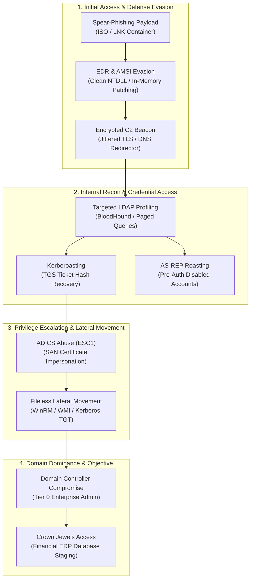

# Enterprise Red-Team Adversary Emulation Framework

[](https://www.python.org/)
[](https://attack.mitre.org/)
[]()
[](LICENSE)

An enterprise-grade Red Team adversary emulation playbook, attack surface analyzer, and full-scope engagement documentation suite modeled after real-world Advanced Persistent Threat (APT) attack chains aligned with the MITRE ATT&CK framework.

---

## Adversary Emulation Architecture



---

## Repository Structure

```text
Enterprise-RedTeam-Operations/
├── .gitignore
├── README.md                                          # Framework architecture and operational guide
├── tools/
│   ├── ad_audit.py                                    # Active Directory & Kerberos attack surface analyzer
│   └── requirements.txt                               # Environment dependencies
├── tests/
│   └── test_ad_audit.py                               # Unit test verification suite
├── playbooks/                                         # Step-by-step technical execution guides
│   ├── 01-initial-access-and-phishing.md              # Container evasion, LNK weaponization, perimeter breach
│   ├── 02-edr-evasion-and-execution.md                # In-memory execution, AMSI patching, indirect syscalls
│   ├── 03-active-directory-privilege-escalation.md    # Kerberoasting, AS-REP Roasting, AD CS ESC1
│   └── 04-lateral-movement-and-persistence.md         # Fileless WinRM/WMI, Golden Ticket, persistence
├── reports/
│   └── 2026-enterprise-redteam-engagement-report.md   # Complete sanitized engagement final report
└── templates/
    ├── rules_of_engagement.md                         # Formal Red Team RoE contract and scope agreement
    └── deconfliction_ioc_ledger.md                    # Operational activity and artifact tracking ledger
```

---

## Tooling & Active Directory Analysis (tools/ad_audit.py)

`tools/ad_audit.py` is a zero-dependency CLI analyzer for evaluating Active Directory accounts, decoding UserAccountControl bitmasks, and identifying high-value Kerberoasting / AS-REP roasting attack paths:

### Key Commands:
```bash
# 1. Run unit tests to verify tooling integrity
python3 -m unittest discover tests

# 2. Decode an integer UserAccountControl bitmask (e.g., 4194816 = DONT_REQ_PREAUTH + NORMAL_ACCOUNT)
python3 tools/ad_audit.py uac 4194816

# 3. Analyze built-in enterprise sample dataset for Kerberoast and AS-REP targets
python3 tools/ad_audit.py analyze --demo

# 4. Ingest an external BloodHound / LDAP export and generate a technical markdown report
python3 tools/ad_audit.py analyze --file ad_users.json --out ad_risk_report.md
```

---

## Adversary Emulation Playbooks

- **[01. Initial Access & Phishing](playbooks/01-initial-access-and-phishing.md)**: Infrastructure staging, container delivery (ISO/VHD) bypassing Mark-of-the-Web (MOTW), and HTML smuggling.
- **[02. EDR Evasion & Execution](playbooks/02-edr-evasion-and-execution.md)**: User-mode unhooking via clean `ntdll.dll` mapping, indirect syscalls (Hell's Gate), and memory patching of `AmsiScanBuffer` and `EtwEventWrite`.
- **[03. Active Directory Escalation](playbooks/03-active-directory-privilege-escalation.md)**: Stealthy LDAP discovery, Kerberoasting (T1558.003), AS-REP Roasting (T1558.004), and AD CS certificate template abuse (ESC1).
- **[04. Lateral Movement & Persistence](playbooks/04-lateral-movement-and-persistence.md)**: Pass-the-Hash, Overpass-the-Hash, WinRM remote execution without dropping binaries, and Golden Ticket generation.

---

## Engagement Deliverables & Templates

- **[Sanitized Red Team Final Report](reports/2026-enterprise-redteam-engagement-report.md)**: Complete 14-day engagement report documenting full kill chain execution, Blue Team detection scorecard, and enterprise remediation roadmap.
- **[Rules of Engagement (RoE) Agreement](templates/rules_of_engagement.md)**: Industry-standard contract establishing operational boundaries, authorization, emergency stop protocols, and trusted contacts.
- **[Deconfliction & IOC Ledger](templates/deconfliction_ioc_ledger.md)**: Time-stamped tracking table for Blue Team correlation and post-engagement artifact remediation.

---

## Legal & Ethical Disclaimer

All playbooks, tools, and technical documentation in this repository are developed strictly for authorized security training, internal red-team simulations, and defensive posture evaluation. Unauthorized testing against systems without prior written authorization under signed Rules of Engagement is strictly illegal.
