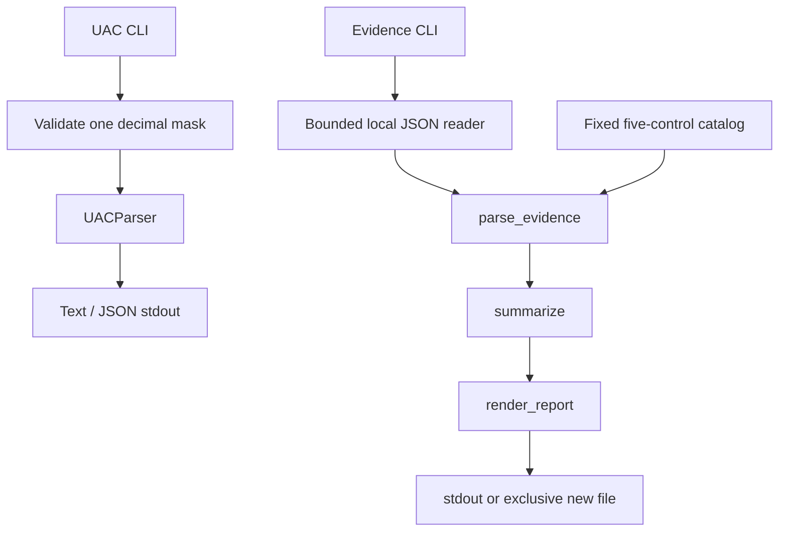

# Architecture

**Project:** Security Assessment & Defensive Evidence Toolkit

The toolkit contains two independent, offline command-line flows. They share the Python standard library but do not share runtime state or data.

## 1. Scalar UAC decoder

`python3 -B tools/ad_audit.py uac MASK [--json]`

1. `argparse` validates an ASCII decimal mask in the unsigned 32-bit range.
2. `UACParser.parse(mask)` decodes the defined UserAccountControl flags and calculates educational heuristic labels.
3. The CLI writes human-readable output or one JSON document to stdout.

The interface accepts one integer mask. There is no account dataset ingestion, LDAP/BloodHound reader, live Active Directory connection or account-level verification. Risk labels are educational heuristics, not findings about a real directory.

## 2. Synthetic evidence scorecard

`python3 -B tools/evidence_report.py --file PATH [--format markdown|json] [--out PATH]`

1. The CLI passes the selected path to `read_evidence(path)`.
2. The reader accepts a bounded (1 MiB maximum), regular, nonsymlink local file; it rejects duplicate JSON keys and non-finite JSON constants.
3. `parse_evidence(raw)` validates exact keys, types, catalog membership, uniqueness, status values and evidence-label rules.
4. `summarize(controls)` calculates supplied status counts and denominator-explicit percentages.
5. `render_report(controls, format)` produces deterministic Markdown or JSON.
6. The CLI writes to stdout by default or calls `write_report(path, report)` to create a new file exclusively.

The fixed catalog is defined in `tools/evidence_model.py`. The model is pure and does not access files or services. Filesystem access and CLI behavior are kept in `tools/evidence_report.py`. The renderer consumes validated records and fixed catalog definitions; it does not verify evidence artifacts.

## 3. Data and status semantics

- Catalog: LAB-C001 Backup restoration, LAB-C002 Alert triage, LAB-C003 Patch review, LAB-C004 Access review and LAB-C005 Incident escalation.
- Submitted statuses: `met`, `not_met`, `inconclusive` and `not_tested`.
- Evaluated = `met + not_met`.
- Evaluation coverage = `evaluated / submitted`.
- Met rate = `met / evaluated`.
- Omitted controls are catalog entries absent from the submitted array; omission is not a status.
- Evidence IDs are synthetic labels only, not artifact files, hashes or attestations.

A zero denominator produces JSON `null` and Markdown `N/A`. Percentages are descriptive properties of supplied synthetic records, not risk scores or compliance results.

## 4. Module interfaces

| Module | Main interface | Responsibility |
|---|---|---|
| `tools/ad_audit.py` | `UACParser.parse(uac_value)` | Decode one scalar UAC mask |
| `tools/evidence_model.py` | `parse_evidence(raw)`, `summarize(controls)` | Pure schema validation and summary calculation |
| `tools/evidence_report.py` | `read_evidence(path)`, `render_report(controls, format)`, `write_report(path, report)`, `main(argv)` | File boundary, deterministic rendering and CLI |

## 5. Architecture flow

## 6. Trust assumptions and non-goals

Paths must be trusted and stable. The reader is not a sandbox and does not promise race-proof access. Output creation is exclusive but not atomic; a failed write or close can leave a partial file for manual inspection. There is no automatic cleanup, database, network operation, live integration, user-defined catalog or production evidence ingestion.

See [evidence schema and CLI contract](evidence-schema.md), [limitations](limitations.md), [glossary](../CONTEXT.md), [contribution guide](../CONTRIBUTING.md) and [ADR 0001](adr/0001-offline-evidence.md).
